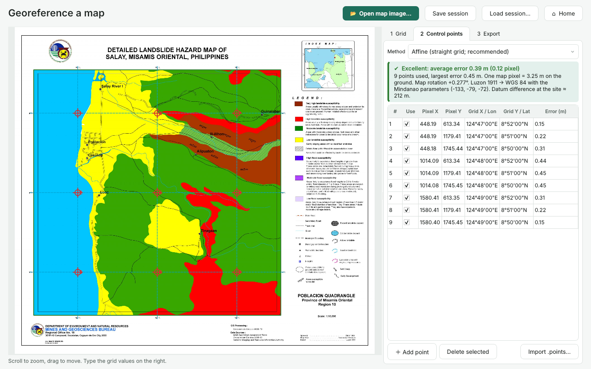
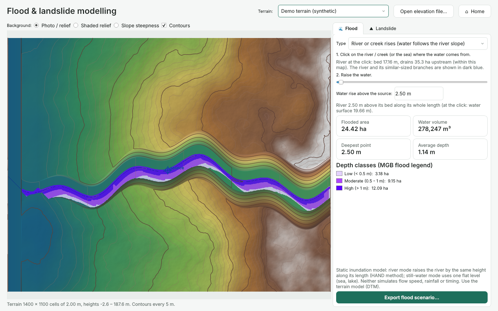
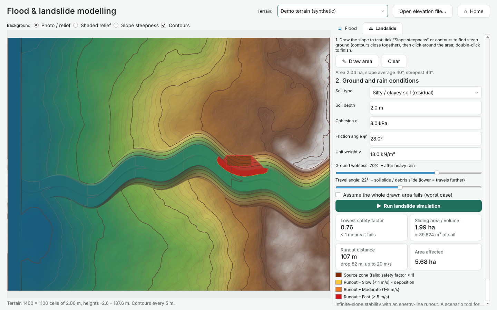

# WhangDoodleGIS

WhangDoodleGIS (developed by Migz Siao) is an offline Windows app for field mapping teams. It has three tools:

1. **Process drone photos** into an orthomosaic, DSM, DTM and contours, exported in any format and coordinate system.
2. **Georeference a map**: scanned or exported maps with a coordinate grid (such as the MGB geohazard maps) become GeoTIFFs for QGIS, and their coloured hazard zones become polygons.
3. **Flood & landslide modelling** on a terrain model: raise a river or the sea with a slider, or test a steep slope and see where a landslide would run.

| Georeferencer | Flood (river rises 2.5 m) | Landslide scenario |
|---|---|---|
|  |  |  |

The photogrammetry is done by **OpenDroneMap (ODM)**, an open-source engine with published accuracy comparable to commercial tools. WhangDoodleGIS installs ODM locally, drives it, checks the photos before processing, and turns the raw outputs into clean GIS files. Nothing needs internet.

---

## Using the app

The window has a menu on the left (Home, Drone mapping, Georeference a map, Flood & landslide, Jobs,
Settings), a title bar with the actions of the current screen, and a status bar showing the jobs folder
and whether the processing engine is ready. **Jobs** lists everything you made: drone mapping jobs,
georeferenced maps and flood/landslide scenarios; double-click one to reopen it.

Every input shows its unit and checks its value while you type:
- coordinates are typed into separate degree / minute / second boxes with an N/S or E/W list (no ° symbol
  needed; Space jumps to the next box; values outside the Philippines are flagged);
- the drone's flight height is the height above the take-off point, in metres or feet, with the
  conversion shown;
- soil and flood values show typical ranges and warn when a value is unusual.

## For field staff

1. **New mapping job.** Drag in the folder of photos copied from the SD card. One folder = one site.
2. **Check.** A map shows where every photo was taken. WhangDoodleGIS flags problems in plain words: photos without GPS, **blurry photos** (left out automatically), low overlap, mixed cameras, or photos from different sites. It also estimates the area, ground resolution and how many photos see each spot.
3. **Outputs.** Pick *Quick preview*, *Standard* or *High detail* (the estimated time for this computer is shown). Choose a coordinate system (Philippine UTM 51N / PRS92 zones are listed), the height reference and, optionally, ground control points.
4. **Processing.** Progress is shown in plain steps. The laptop is kept awake. If something fails, the message says why and what to do (e.g. "the computer ran out of memory, choose Standard"). **Try again** continues where it stopped.
5. **Results.** View the orthomosaic, DSM and DTM, with coordinates and elevation under the mouse. Then use *Open GIS folder*, *Open in QGIS*, or *Copy to USB drive*.

### What you get (`<job>/GIS/`)

| File | Contents |
|---|---|
| `*_orthomosaic.tif` | Cloud-Optimized GeoTIFF, RGB + transparency, lossless |
| `*_DSM.tif` | Surface model (tops of trees/buildings), float32 metres, nodata -9999 |
| `*_DTM.tif` | Bare-earth terrain model |
| `*_contours_1m.shp` | Contours from the DTM, field `ELEV`, `MAJOR=1` every 5th line, with `.prj` |
| `*_pointcloud.laz` | Classified point cloud |
| `*_quality_report.pdf` | ODM's quality report |
| `*_README.txt` | Coordinate system, height reference, resolution and accuracy, in plain text |

All rasters open directly in QGIS, ArcGIS Pro and Global Mapper.

### Exporting a job (Results → **Export…**)

You can pick any layer, any format and any coordinate system: WGS 84, UTM 50/51/52N, PRS92 zones I–V, PRS92 or Luzon 1911 lat/long, Luzon 1911 zones, Web Mercator, or any EPSG code you type.

| Layer | Raster | Vector |
|---|---|---|
| Orthomosaic | GeoTIFF, PNG + world file, JPEG + world file, KMZ | – |
| DSM / DTM | GeoTIFF (float), ASCII grid, XYZ | – |
| Shaded relief | GeoTIFF, PNG, JPEG, KMZ | – |
| Contours | GeoTIFF (lines burned in, value = elevation) | GeoPackage, Shapefile, GeoJSON, KML, DXF (3D lines at their elevation) |
| Mapped area outline | – | GeoPackage, Shapefile, GeoJSON, KML, DXF |

Contours are traced in the target system, so they line up exactly with the exported DTM. Every export includes a README stating the coordinate system and any datum shift that was applied.

---

## Georeferencer

1. **Open map image.** WhangDoodleGIS finds the map frame, the grid tick marks around it and the small "+" grid crosses inside it, all to sub-pixel accuracy. Slightly rotated scans are straightened automatically.
2. **Grid tab.** Each grid line has a zoomed picture of its label (click it to zoom the map there). Type the first longitude and latitude and the spacing (e.g. 1′), then press **Fill the rest**. Choose the datum printed on the map; MGB/NAMRIA maps state *Luzon 1911*.
3. **Control points tab.** Shows one point per grid intersection, the error of each point in metres, and a verdict. Points can be switched off, added by clicking (for maps without a grid), or imported from a QGIS `.points` file.
4. **Export tab.** Choose the output coordinate system and formats (GeoTIFF / PNG / JPEG / KMZ), whether to cut off the legend and margins, a QGIS `.points` file, and optionally **map classes → polygons**. The MGB flood and landslide presets turn the coloured zones into GeoPackage/Shapefile/KML/DXF polygons, each with its class name, legend description and area, plus a class GeoTIFF with a colour table.

The same is available from the command line for many map sheets:
`fieldortho-cli georef map.jpg --lon "124°47'E" --lat "8°52'N" --crs EPSG:3125 --classes mgb_flood`

---

## Flood & landslide modelling

Choose the terrain: a processed job's DTM (the orthomosaic is used as background) or any elevation GeoTIFF.

**Flood.** Click a river or the sea, then move the slider.
- *River or creek rises* (default) uses the HAND method (Height Above Nearest Drainage). The water rises by the slider amount above the riverbed *along the whole river*, following its slope.
- *Still water* uses one flat level, for sea surge, lakes or ponding. Flooding can be limited to areas connected to the clicked point or to the map edge.

You get the flooded area, volume, maximum and average depth, and area per MGB depth class (low < 0.5 m, moderate 0.5–1 m, high > 1 m). Exports: depth GeoTIFF/ASCII/XYZ, a coloured flood map (PNG/KMZ) and flood-zone polygons.

**Landslide.** Draw the slope to test; the slope-steepness view and contours help find steep ground. Then choose the soil type (or type cohesion, friction angle, unit weight, depth), the ground wetness and the travel angle, and press *Run*.
- Stability uses the infinite-slope factor of safety per cell. Cells with a safety factor below 1 form the source zone.
- Runout uses an energy-line (travel-angle) model following the fall line, capped at 20 m/s. You get the source area and volume, runout distance and drop, speed and affected area. Exports: zone polygons, a factor-of-safety raster, a velocity raster and a map image.

Both models are screening and scenario tools. They do not simulate flow dynamics, rainfall timing or site-specific geotechnics.

---

## Accuracy checks (run on the six Salay maps supplied)

| Check | Result |
|---|---|
| Grid detection: frame + 3 × 3 grid lines on all 6 maps | 6 / 6 |
| Tick marks vs interior crosses (independent marks) | agree within 0.2–0.6 px |
| Affine fit, 9 control points per map | RMSE 0.23–0.39 m (map pixel = 3.25 m) |
| Map rotation in UTM 51N vs theoretical meridian convergence at 124.8°E | within 0.03° (0.27–0.29° vs 0.277°) |
| Poblacion and Ampenican sheets georeferenced separately; shared 190 m strip | misalignment 0.09 m |
| Grid crosses in the exported WGS 84 GeoTIFF vs datum-transformed coordinates | 1.1–2.5 m mean (under 1 map pixel) |
| Hazard-zone extraction vs the maps' fill colours | 99.98–99.99 % of pixels agree |
| Barangay markers vs PhilAtlas coordinates (rough reference) | ~40 m mean offset, no systematic shift |

**Datum.** The maps state *Luzon 1911*. Two official transformations to WGS 84 exist, one for Mindanao and one for the rest of the Philippines. Their areas overlap, and PROJ picks the non-Mindanao one by default, which would misplace Salay by **20.5 m**. WhangDoodleGIS chooses by location and writes the parameters explicitly into the GeoTIFF and GeoPackage outputs. Treating Luzon 1911 labels as PRS92 would be **34 m** off; treating them as WGS 84 would be about **200 m** off. Shapefile `.prj` files cannot store the datum parameters, so for Luzon 1911 output prefer GeoPackage; the export README warns about this.

**Models** are tested against hand calculations:
- Flood: area, volume and depth classes on a V-valley; closed hollows correctly excluded.
- River rise: constant flooded width along a sloping river.
- Stability: the infinite-slope factor of safety.
- Runout: stops where the energy line meets the ground (within 3 cells) for 15°, 22° and 30°, downhill in all four directions; reach angle measured on the demo terrain is 15.1° / 22.1° / 30.1°.

---

## Installing

Download from the project's **Releases** page on GitHub:

| File | When to use |
|---|---|
| `WhangDoodleGIS_Setup_<version>_Online.exe` | Small. During setup it downloads and installs the latest OpenDroneMap engine (about 1-2 GB, internet needed once). |
| `WhangDoodleGIS_Setup_<version>_Offline.exe` | Everything inside. For laptops that are offline when installed. |

Run the setup and click Next. It installs:
- WhangDoodleGIS, with all GIS libraries and the EGM96 geoid grid;
- the OpenDroneMap engine into `C:\ODM`, including its Visual C++ runtime;
- shortcuts, and a `Documents\WhangDoodleGIS Jobs` folder.

Installing over an earlier FieldOrtho or WangDoodletheGIS version removes the old program automatically; jobs, settings and the engine are kept.

Choose the "WhangDoodleGIS only" type to skip the engine. Georeferencing and modelling work without it, and the engine can be added later from **Settings → Download and install engine**.

The installer is not code-signed, so Windows may show "Windows protected your PC". Click *More info → Run anyway*. IT staff can install silently with `WhangDoodleGIS_Setup_x.exe /VERYSILENT /SUPPRESSMSGBOXES /NORESTART`.

Requirements: Windows 10/11 64-bit, 16 GB RAM recommended (32 GB for *High detail*), several GB free disk per job.

### How the installers are built (automatic)

Every push to `main` runs `.github/workflows/build-windows.yml` on a GitHub Windows machine. It:
1. downloads every resource: Python libraries, the EGM96 geoid grid, the latest OpenDroneMap Windows setup (with SHA-256), and Inno Setup;
2. runs the automated tests on Windows;
3. packages the app with PyInstaller and compiles the Online and Offline installers;
4. **install test:** silently installs the Online edition (which downloads the engine), then checks the shortcuts, the engine, the georeferencer on a real MGB map and that the GUI starts;
5. **real engine test:** processes 30 public drone photos with OpenDroneMap through the installed app, into a job folder whose name contains spaces;
6. publishes both installers on the Releases page (tags `v*` become normal releases);
7. writes a status report to the `ci-status` branch.

To build on your own Windows PC instead: `powershell -ExecutionPolicy Bypass -File packaging\build_windows.ps1` (needs Python 3.12; everything else is downloaded).

### Run from source (any OS, for development)

```bash
pip install -r requirements.txt
python -m fieldortho.app                 # GUI
python -m fieldortho.cli check  PHOTOS   # photo check only
python -m fieldortho.cli process PHOTOS --name "Site A" --preset standard --crs EPSG:32651
```

---

## How it works

```
photos ──► check (EXIF/XMP GPS, blur, overlap, area, GSD)
       ──► job folder (hard links to photos, gcp_list.txt)
       ──► OpenDroneMap  (run.bat <job> --dsm --dtm --cog ... ; progress via UDP 6367 + log)
       ──► GIS export   (reproject, COG, nodata, geoid/offset shift, contours, previews, README)
```

```
fieldortho/
  core/photos.py     EXIF/XMP reading, blur detection, survey checks and estimates
  core/presets.py    Quick / Standard / High → ODM options; stage names → plain-language steps
  core/engine.py     finds ODM (C:\ODM, bundled, Settings, Docker), runs it, progress, friendly errors
  core/gisexport.py  ODM outputs → GIS deliverables (pure Python: rasterio, pyproj, contourpy, pyshp)
  core/gcp.py        GCP CSV, candidate photos, ODM gcp_list.txt, check points
  core/crs.py        datum-aware coordinate systems (Luzon 1911 Mindanao / other, PRS92)
  core/exporters.py  raster + vector writers (GeoTIFF, PNG/JPEG + world file, KMZ, ASC, XYZ, GPKG, SHP, GeoJSON, KML, DXF)
  core/job_export.py the Export... dialog's engine for drone jobs
  core/georef.py     grid detection, control points, polynomial fit, warping
  core/mapclasses.py MGB hazard colours/hatching -> class polygons
  core/terrain.py    DEM loading, slope, hillshade
  core/hydro.py      priority-flood drainage, flow accumulation, HAND
  core/flood.py      still-water and river-rise inundation
  core/landslide.py  infinite-slope stability + energy-line runout
  core/pipeline.py   end-to-end job runner (shared by GUI and CLI)
  gui/               PySide6 wizard, photo map, raster viewer, GCP tagger, settings
  cli.py             command-line interface
tests/               automated tests + headless GUI walkthrough + ODM test double
packaging/           PyInstaller spec, Inno Setup script, Windows build script
```

**Accuracy notes**

- Without GCPs, absolute position is only as good as the drone GPS (typically 1-5 m). Relative measurements (distances, areas, volumes) are much better.
- Ground control points: load a CSV (`name, easting, northing, elevation`), click each target in 3+ photos, and spread at least 5 points around the site. Mark some as **check points**; the results then report the height RMSE against them.
- **Heights:** many DJI drones record sea-level-ish (EGM96) altitudes, while RTK/PPK and GNSS GCPs are usually ellipsoidal. Use *Convert ellipsoid heights to sea level (EGM96)* or *Shift by a fixed amount* (e.g. to tie to a local benchmark) as needed. The choice is written to the README in every delivery.
- DTMs under dense canopy are interpolated, because the camera never sees the ground there.

---

## Testing status

Tested automatically here, on Linux, with the real 77-photo `odm_data_aukerman` dataset:

- EXIF/GPS reading, UTM selection, area/GSD/overlap estimates. The blur detector correctly flags the visibly motion-blurred photo DSC00308.
- The full job pipeline, using a **test double of the ODM command line** (`tests/fake_odm`). It mimics ODM 3.6's CLI, log format, UDP progress, `log.json` and output layout. Covered: progress, failure messages, resume after failure, reprojection (UTM, WGS84, PRS92), height shift, COG output, contours shapefile, check-point RMSE, GCP file writing.
- Every GUI screen, driven headless (`tests/gui_walkthrough.py`).
- The PyInstaller build (frozen CLI processed a full job; frozen GUI starts).

Also tested: 16 georeferencer tests on the six supplied MGB maps, 13 model tests, every new screen driven headless (`tests/gui_walkthrough2.py`, using `tests/make_demo_dem.py`, a **synthetic** demo terrain placed at Salay), and the frozen app exporting Luzon 1911 output with the datum parameters intact.

**On Windows:** every build installs the real installer and runs OpenDroneMap on 30 drone photos (see *How the installers are built*). Results for each build are on the Releases page and in `STATUS.md` on the `ci-status` branch. Field checks (your own drone, GCPs, local terrain) remain your acceptance test.

```bash
pip install pytest && python -m pytest -q tests
QT_QPA_PLATFORM=offscreen python tests/gui_walkthrough.py shots/
```

## Disclaimer

WhangDoodleGIS is developed by Migz Siao and is provided as is, without warranty. The accuracy of its maps,
elevation models and other outputs depends on the data entered and the settings used. Flood and landslide
models and hazard scenarios are user-run simulations. They do not replace expert knowledge, or the official
hazard maps and assessments of mapping and scientific institutions such as MGB, NAMRIA, DOST-PAGASA and
DOST-PHIVOLCS. Local terrain awareness, professional judgement and the user's own discretion remain essential.
WhangDoodleGIS and its developer are not responsible for any misinformation, decision or consequence arising
from the use or sharing of its results.

## Licensing

OpenDroneMap is AGPL-3.0. WhangDoodleGIS runs it as a separate program and does not link to it. If you distribute the installer with ODM bundled, include ODM's license and point to its source (github.com/OpenDroneMap/ODM). Get legal advice before selling a closed-source product that bundles it. The other dependencies are permissive or LGPL (PySide6/Qt LGPL; rasterio/GDAL, pyogrio, pyproj, numpy, scipy, shapely, Pillow, contourpy, pyshp under BSD/MIT-style licences).
